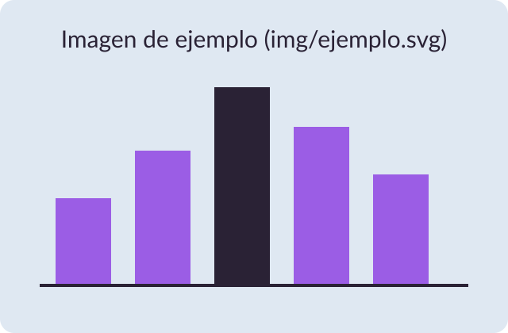

---
# Plantilla de clase (nvim_hades). Atajos en Neovim (buffer quarto):
#   ,qp  vista previa en el navegador (se recarga al guardar)
#   ,qh  generar el .html
#   ,qP  exportar a PDF (decktape)
# En el navegador: S = vista del ponente (notas, reloj, siguiente diapositiva),
# F = pantalla completa, O = vista general, ? = ayuda.
title: "{{title}}"
subtitle: "Asignatura · Tema"
author: "{{author}}"
date: "{{date}}"
date-format: long
lang: es
format:
  revealjs:
    theme: [default, hades.scss]
    # 16:9
    width: 1280
    height: 720
    slide-number: c/t
    footer: "{{title}}"
    transition: fade
    # Un único .html que funciona sin internet (para clase)
    embed-resources: true
    self-contained-math: true
    html-math-method: katex
    code-line-numbers: false
    title-slide-attributes:
      data-background-color: "#2A2235"
---

# Primer bloque {background-color="#2A2235"}

## Texto e imagen

:::: {.columns}

::: {.column width="55%"}
- Cada `##` es una diapositiva
- Cada `#` abre una sección (fondo morado oscuro)
- Las imágenes van en `img/`
:::

::: {.column width="45%"}
{fig-align="center"}
:::

::::

::: notes
Notas para el ponente: solo se ven en la vista del ponente (tecla S).
:::

## Fórmulas

La media aritmética $\bar{x}$ de una muestra de tamaño $n$:

::: {.formula}
$$
\bar{x} = \frac{1}{n}\sum_{i=1}^{n} x_i
$$
:::

Y la varianza muestral, $s^2 = \frac{1}{n-1}\sum_{i=1}^{n}(x_i - \bar{x})^2$.

::: notes
Recordar por qué se divide entre $n-1$.
:::

## Cajas

::: {.definicion}
**Definición.** Una *variable aleatoria* asigna un número a cada resultado de un experimento.
:::

::: {.ejemplo}
**Ejemplo.** El número de caras al lanzar tres monedas.
:::

::: {.nota}
**Nota.** También existen `.resumen` y `.formula`.
:::

## Paso a paso

::: {.incremental}
- Primero aparece esto
- Luego esto
- Y al final esto
:::

. . .

Una pausa (`. . .`) muestra lo siguiente al avanzar.

## {background-image="img/ejemplo.svg" background-size="contain"}

::: notes
Diapositiva sin título con una imagen a pantalla completa: `##` vacío con
`background-image`.
:::

# Segundo bloque {background-color="#2A2235"}

## Código

```r
x <- c(4, 8, 15, 16, 23, 42)
mean(x)
```

Con ```` ```{r} ```` (o ```` ```{python} ````) el código se ejecuta al generar las
diapositivas y se muestra el resultado.

## Tabla

| Estadístico | Fórmula | Interpretación |
|---|---|---|
| Media | $\bar{x} = \frac{1}{n}\sum x_i$ | Valor central |
| Mediana | $x_{(n+1)/2}$ | Valor que deja la mitad a cada lado |
| Desviación típica | $s = \sqrt{s^2}$ | Dispersión respecto a la media |
