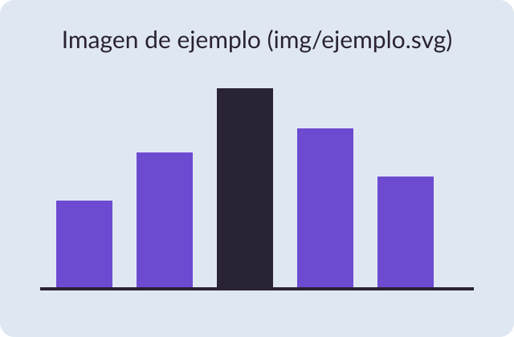

---
# Presentación de clase (nvim_hades). Cada "##" es una diapositiva.
# Neovim: ,qp vista previa (se recarga al guardar) · ,qh html · ,qP pdf.
# En el navegador: S = vista del ponente (notas, reloj, siguiente diapositiva),
# F = pantalla completa, O = vista general, ? = ayuda.
# Colores y letra: clase.scss (arriba del todo).
pagetitle: "{{title}}"
format:
  revealjs:
    theme: [default, clase.scss]
    width: 1280
    height: 720
    margin: 0.05
    center: false
    slide-number: c/t
    transition: fade
    transition-speed: fast
    # Un único .html que funciona sin internet
    embed-resources: true
    # fórmulas con MathML: las dibuja el navegador, sin internet
    html-math-method: mathml
    include-after-body: encajar.html
    pdf-max-pages-per-slide: 1
---

## {.portada}

[Asignatura · Tema]{.titulo-pequeno}

[{{title}}]{.titulo}

&nbsp;

{{author}}

::: notes
Notas para el ponente: solo se ven en la vista del ponente (tecla S).
:::

# Primer bloque

Un `#` es un divisor de sección (esta línea es opcional)

## Texto y listas

- Cada `##` es una diapositiva; el título va en la banda de arriba
- Las listas se escriben como siempre
  - con sangría para el segundo nivel
- **Negrita**, *cursiva*, [texto en rojo]{.rojo}, [en verde]{.verde}, [en azul]{.azul}

::: {.caja}
Un cuadro destacado: `::: {.caja}`. También `{.aviso}` (rosa) y `{.gris}`.
:::

::: notes
Si hay demasiado texto, la letra de la diapositiva se reduce sola.
:::

## Imagen que ocupa lo que queda

Una línea de texto encima

{fig-align="center" .r-stretch}

::: notes
`{.r-stretch}` hace que la imagen ocupe todo el alto libre de la diapositiva.
Sin él, `{width="60%"}` fija el ancho.
:::

## Texto e imagen en columnas

:::: {.columns}

::: {.column width="55%"}
- Columna de texto
- La imagen se ajusta al ancho de su columna
:::

::: {.column width="45%"}
{fig-align="center"}
:::

::::

## Paso a paso

- Lo que va después de `. . .` aparece al avanzar

. . .

- Como esto

. . .

::: {.aviso .centrado}
O un cuadro con la respuesta
:::

## Respuestas en la misma línea

- ¿Pregunta 1?\
  [→ respuesta que aparece al avanzar]{.fragment .azul}
- ¿Pregunta 2?\
  [→ otra respuesta]{.fragment .azul}

::: notes
`[texto]{.fragment}` aparece al avanzar; la barra `\` al final de una línea
la parte sin empezar otro punto.
:::

## Idea clave

::: {.grande .centrado}
Una frase grande para lo que tienen que recordar
:::

## Fórmulas y código

La media de una muestra de tamaño $n$:

$$
\bar{x} = \frac{1}{n}\sum_{i=1}^{n} x_i
$$

```r
x <- c(4, 8, 15, 16, 23, 42)
mean(x)
```

## {.sin-titulo background-image="img/ejemplo.svg" background-size="contain"}

::: notes
Diapositiva sin título con una imagen a pantalla completa. Con
`background-size="contain"` se ve entera en cualquier pantalla (16:9, 4:3...).
:::

# Segundo bloque

## {.portada}

[¿Preguntas?]{.titulo}

&nbsp;

{{author}}
